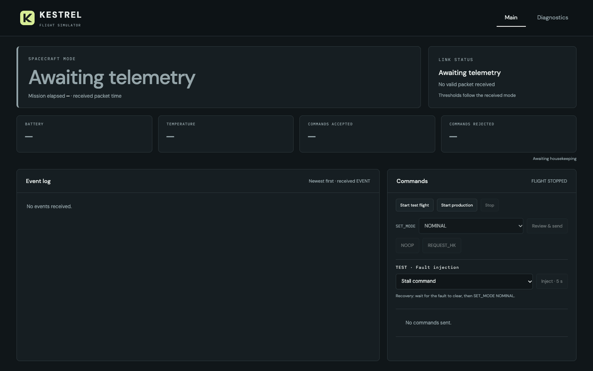
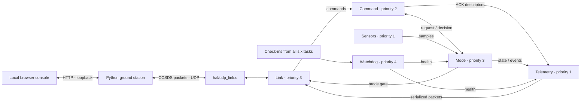

# Kestrel

[](https://github.com/zxcv616/kestrel/actions/workflows/ci.yml)

Kestrel is a laptop-based CubeSat flight-software simulator: six C11 tasks on FreeRTOS exchange copied queue messages, receive CCSDS-style commands over loopback UDP, and send housekeeping, attitude, event and acknowledgement packets to a Python ground station. A local browser console shows mode, health, faults and command results. The project implements SAFE, NOMINAL and LOW_POWER operation, test-only fault injection, watchdog check-ins, and evidence for 20 clarified MVP requirements. It is a software demonstrator, not flight-qualified hardware.



Recorded from the live console: boot → NOMINAL → Command task stall → SAFE → FAULT CLEARED → operator-commanded recovery. No telemetry is fabricated for the recording.

## Architecture



Each task owns its mutable state. Tasks communicate through statically allocated copy queues; only Link owns the nonblocking transport adapter. Packet codecs live in `fsw/src/ccsds/`, tasks in `fsw/src/tasks/`, and UDP in `fsw/src/hal/`. See [design decisions](docs/design.md) and the [packet contract](docs/icd.md).

## Run it

Requires CMake 3.24+, Git, a C11 compiler, Python 3.9+, and Node.js 18+. Install Apple's command-line tools on macOS or `build-essential` on Ubuntu. The first configure downloads pinned FreeRTOS and Unity sources. No Python packages are required.

```sh
git clone https://github.com/zxcv616/kestrel.git
cd kestrel
cmake -S . -B build -DCMAKE_BUILD_TYPE=Debug
cmake --build build --parallel
python3 tools/dashboard.py serve --run-demo
```

Open **http://127.0.0.1:8765**. Start a test flight, confirm **SET_MODE NOMINAL**, and inject **Stall command**. Watch SAFE and its fault event, wait for **FAULT CLEARED**, then confirm **SET_MODE NOMINAL** to recover. Startup sends no automatic ground commands. Diagnostics contains charts, stack/watchdog health, packet inspection and CSV export. Stop the console with Ctrl-C before restarting it.

To run the same checks as CI, also install `cppcheck`, then:

```sh
tools/ci.sh build Debug
```

[GitHub Actions](https://github.com/zxcv616/kestrel/actions/workflows/ci.yml) runs on **every push and pull request**, in Debug and Release: build with `-Wall -Wextra -Werror`, all **32 CTest entries**, **7 scenario checks**, cppcheck, and the **20-requirement trace check**. Source/report hashes bind each hosted result to its checkout; reports and console exports are retained as artifacts. See [release and demo reproduction](docs/release.md).

## Requirements and traceability

This table summarizes the [clarified requirements register](docs/requirements.md), derived from the [original MVP spec](Kestrel%20Flight%20Software%20MVP%20Spec.pdf). Each linked evidence path contains the actual checks; a test name alone is not a passing result. The Actions run for a commit supplies its fresh pass/fail evidence.

| ID | Required behavior | Verification |
| --- | --- | --- |
| FSW-001 | Boot into SAFE within 2 s; first HK has valid sensors | [Boot UDP test](tests/integration/flight_link.py) |
| FSW-002 | Leave SAFE only by valid command with healthy prerequisites | [Mode integration](tests/integration/flight_modes.py), [unit checks](tests/unit/test_mode.c) |
| FSW-003 | NOMINAL HK at 1 Hz within 50 ms under tested host conditions | [Timing check](tests/integration/flight_modes.py) |
| FSW-004 | Accept HK periods 250–10000 ms; reject others | [Rate boundaries](tests/integration/flight_modes.py) |
| FSW-005 | Valid headers and CRC on emitted packets | [C/Python/browser codec checks](tests/protocol) |
| FSW-006 | Independent per-APID sequence counters, wrapping at 16384 | [C](tests/unit/test_packet.c), [Python](tests/protocol/test_codec.py) |
| FSW-007 | Reject malformed and unsupported commands | [Invalid-command UDP check](tests/integration/flight_link.py) |
| FSW-008 | ACK within 100 ms while command/link paths are operational | [Deadline and burst check](tests/integration/flight_link.py) |
| FSW-009 | Report accepted/rejected counts with defined reset behavior | [Counter check](tests/integration/flight_modes.py) |
| FSW-010 | LOW_POWER below 20%; recover at ≥30% | [Battery hysteresis](tests/integration/fault_recovery.py) |
| FSW-011 | SAFE within 1 s for critical sensor faults | [Fault boundaries and deadlines](tests/integration/fault_recovery.py) |
| FSW-012 | SAFE within 4 s for supported task stalls | [Watchdog check](tests/integration/fault_recovery.py), [Mode detection](tests/integration/hardening.py) |
| FSW-013 | Enforce the SAFE command allowlist | [Permission check](tests/integration/flight_modes.py) |
| FSW-014 | Emit mode/fault events; report dropped event enqueues | [Events](tests/integration/fault_recovery.py), [overflow](tests/integration/hardening.py) |
| FSW-015 | ATT at 1 Hz only in NOMINAL; purge obsolete queued ATT | [Mode checks](tests/integration/flight_modes.py), [outage](tests/integration/hardening.py), [backpressure](tests/smoke/link_gate.c) |
| FSW-016 | Static allocation in flight application code | [Source-bound inspection](docs/verification/FSW-016.json) |
| FSW-017 | Queue-only exchange of mutable application state | [Source-bound inspection](docs/verification/FSW-017.json) |
| FSW-018 | Fault injection absent from production builds | [Build inspection](tools/release_check.py) |
| FSW-019 | Warning-clean build and cppcheck | [Workflow](.github/workflows/ci.yml), [inspection](tools/release_check.py) |
| FSW-020 | All commands/telemetry supported; received packets logged to CSV | [Real mission and CSV round-trip](tools/record_m5.py) |

## Known limitations

- **Fixed-value sensors:** normal battery, voltage, temperature and attitude rates are fixed simulated baselines. Injections change them temporarily; there is no orbital, battery-drain or attitude dynamics model.
- **POSIX timing is not hard real-time:** deadlines are measured on a host OS. FreeRTOS buffer stack marks do not measure its separate pthread execution stacks; the host runtime also allocates memory outside the application's static-allocation guarantee.
- **Progress-based watchdog not yet built:** current check-ins prove task liveness, not useful work. A task can keep checking in without making progress. Permanent Mode, Watchdog or scheduler failure requires an independent hardware watchdog/reset, deferred to phase 2.
- **UDP is not guaranteed delivery:** queue capacity and traffic assumptions bound the checks. Already-sent datagrams cannot be recalled; no automatic ground retries or authenticated radio transport are provided.
